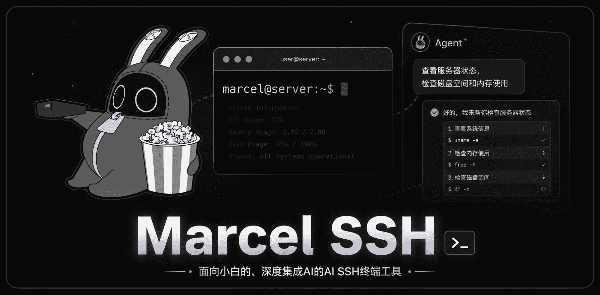
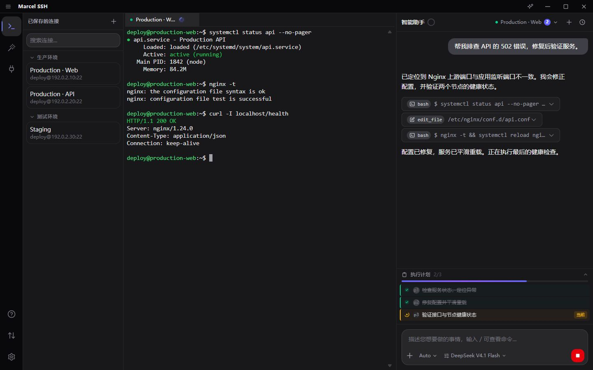

<p align="center">
  
</p>

<h1 align="center">Marcel SSH</h1>

<p align="center">
  <strong>服务器上的事，交给 Marcel。</strong>
</p>

<p align="center">
  <a href="https://github.com/q541810/Marcel_ssh/releases/latest"></a>
  
  <a href="LICENSE"></a>
</p>

<p align="center">
  <a href="https://github.com/q541810/Marcel_ssh/releases/latest">下载最新版本</a> ·
  <a href="#快速开始">快速开始</a> ·
  <a href="docs/mcp-server.md">MCP 接入</a> ·
  <a href="docs/plugin-development.md">插件开发</a> ·
  <a href="https://github.com/q541810/Marcel_ssh/issues">反馈问题</a>
</p>

Marcel SSH 是一款开源的 **AI 原生 SSH 客户端**，支持 Windows 与 Android。

把终端、文件管理和 Agent 放在同一个工作空间。从排查故障到部署服务，说出目标，让 Agent 制定计划、调用工具、执行操作并验证结果。

- **说出目标，Agent 动手**：执行命令、编辑文件、SFTP 传输、跨机器协同，每一步工具调用都可查看，终端随时可以接手。
- **你的 Agent，也能接入**：Claude Code、zcode 等工具通过 MCP 复用 Marcel 保存的连接，密码和私钥不必写进提示词。
- **模型由你选择**：DeepSeek、Qwen 等兼容 OpenAI 接口的模型服务都能接入。Marcel 免费开源，调用费用只付给你选择的提供商。
- **放手，但有底线**：格式化磁盘、删除系统目录这类命令，在任何模式下都会被拦下；凭据加密保存，认证在本机完成。



_真实产品界面，使用脱敏示例数据。_

## 两种方式，接手服务器上的工作

### 直接使用 Marcel Agent

添加服务器连接，配置模型，然后描述你要完成的事情：

> “检查网站为什么出现 502，修复后验证服务。”
>
> “在测试机上部署这个项目，配置 Nginx。”
>
> “把旧机器上的服务迁移到新机器，并检查运行状态。”

复杂任务会先拆成执行计划，再逐步执行命令、读写和编辑文件、通过 SFTP 上传下载，必要时联网查资料。每一步工具调用都留在对话里，可以展开查看；需要时，随时亲自接手终端。

### 在熟悉的工具里，顺手操作服务器

已经在使用 Claude Code、zcode、DeepSeek Harness 或其他支持 MCP 的工具？开启 Marcel 的 MCP Server，它们就能直接调用 Marcel 的 SSH 与 SFTP 工具，复用你已保存的连接。查日志、传文件、改配置、验证部署，都不必离开原来的工作流。

无需反复配置连接参数，也无需把 SSH 密码或私钥写进提示词。

- **Windows**：在 **设置 → 工具能力 → 让外部 Agent 接入 Marcel SSH** 中复制客户端配置，支持 stdio 与 HTTP。
- **Android**：在 **设置 → MCP 服务** 中开启，通过 HTTP 接入。

> [!NOTE]
> 外部 Agent 的调用不经过 Marcel 的命令审批与风险评估，执行与否由外部 Agent 负责。具体配置与使用边界见 [MCP Server 文档](docs/mcp-server.md)。

## 为什么选择 Marcel

### 长任务，也能一步步推进

复杂任务需要持续跟踪目标与进度。

Marcel 用 Plan 拆解任务、记录执行状态；对话变长时自动压缩上下文，Agent 需要时还能检索被压缩的历史原文，关键线索不会丢。

- **后台作业**：耗时命令转入后台运行，完成后 Agent 自动接手结果，继续下一步。
- **子 Agent**：多个方向的调研并行展开，还可以为子 Agent 指定更快或更便宜的模型。
- **发送队列**：任务运行中想到的下一件事，先排进队列，本轮完成后自动发送。
- **会话分叉**：从任意一轮分出新对话，换个思路重试，原对话原样保留。

### 记得你，也记得每一台机器

换个会话，不必从头交代。

长期记忆分为全局、分组与单台机器三级：你的使用习惯、一组机器的共同约定、某台机器的部署细节，都会在新会话中自动带入。Agent 记下的内容以卡片显示在对话中，可以就地修改或撤销；开启后台复盘后，一段对话结束时还会自动整理值得记住的内容。

记忆只保存在本机。

### 配置跟着你走，数据还在你自己手里

在桌面和手机之间同步你的设置、连接、快捷指令、技能与已信任主机的指纹，不用一台台重配一遍。

同步不经过我们的服务器：数据加密后存在**你自己的位置**——坚果云、Nextcloud 这类 WebDAV 网盘，或者你自己的某台服务器（SFTP）。恢复密钥只在你手里，云端只有看不懂的密文。改动按字段自动合并，两台设备改了不同地方不会互相覆盖，也不会弹冲突框让你选。

密码、私钥口令这类机密本期不参与同步（它们本来就在系统密钥链里）。

### 多台机器，一个任务

在你指定的机器范围内，让 Agent 跨连接处理业务修复、环境检查与服务迁移。

连接和工具调用由 Marcel 管理，每条命令都标明目标机器。你可以在同一个任务中查看进展，不必在多台服务器之间来回复制命令与结果。

### 会查资料，也会画图

- **联网搜索**：支持本机浏览器，以及 Brave、Tavily、DeepSeek 等搜索服务和自定义接口。查文档、查报错，不用切出去。
- **交互式可视化**：对比数据、观察趋势、梳理架构时，Agent 可以直接在对话里绘制图表、对比面板或交互演示，手机上同样可用。

### 模型与成本，由你选择

支持自定义模型提供商，按任务需要选择模型、API 或订阅。可以同时配置多个提供商，按会话切换模型与思考强度，随时查看上下文占用与 token 用量。

内置文件读写、编辑与 SFTP 工具，让 Agent 直接完成操作，减少反复拼接命令、处理文件和摸索连接方式带来的试错。你也可以沿用已有的第三方订阅，让工具配合自己的使用习惯与预算。

Marcel SSH 免费开源，模型调用费用按你选择的提供商计费。

## 放手，但有底线

### 审批方式，适应你的工作节奏

三种模式，按任务随时切换：

| 模式 | 适合 | 执行方式 |
| --- | --- | --- |
| **Plan** | 先摸清情况，再决定怎么做 | 只调研、制定计划，不开放文件写入与编辑 |
| **Agent** | 日常运维 | 按你设的规则或白名单执行命令，需要确认的先询问你；修改文件前先预览改动 |
| **Auto** | 放手交给 Agent | 全程无需人工介入 |

无论哪种模式，命令都要先经过风险评估：

- **灾难性操作直接拒绝**：格式化磁盘、删除系统目录等命令不会执行，原因会交给 Agent，让它换一种做法。
- **系统级操作强制审批**：涉及系统级命令或受保护路径时，必须由你确认，白名单也不能放行。Auto 模式下默认不打断，可以打开「Auto 模式强制审批」保留这道确认。
- **可选的模型审批**：由 **LLM 或 Jev** 对操作再做一层判断。需要人工确认时，界面会列出命令、目标机器与判断理由。

风险评估是对命令的检查与把关，不是隔离沙箱。请只在你有权管理的机器上使用 Agent。

### 凭据加密保存，连接由本机处理

让 Agent 操作服务器，无需把 SSH 密码或私钥交进提示词。Marcel 在本机管理认证，并为保存的凭据提供加密保护。

- **导入的 SSH 私钥使用 AES-256-GCM 加密保存**：应用目录中保存的是密文；用于加密的主密钥由系统凭据存储保管。
- **SSH 密码与模型 API Key 使用系统级凭据保护**：Windows 使用系统凭据存储，Android 使用 Android Keystore 加密保存，不以明文写入普通配置文件。
- **保留私钥自身的密码保护**：带 passphrase 的私钥导入后保留原有加密形态，Marcel 的存储加密再提供一层保护。
- **认证在本机完成**：连接时由 Rust 后端读取和解密所需私钥，敏感数据在不再需要时进行内存清理。

Agent 处理任务时，命令、文件内容和工具输出仍可能发送给你选择的模型提供商。

## 生于 Agent，不止于 Agent

不使用 AI 时，Marcel 仍然是一款完整的 SSH 客户端。

- **SSH 终端**：多标签、多连接，支持符合 Windows 使用习惯的复制粘贴与点击定位光标；内置 Nerd Font，也可挑选本机已安装的等宽字体，Ctrl + 滚轮或双指捏合缩放字号。
- **连接管理**：分组、拖拽排序与置顶，常用的服务器始终在手边。
- **SFTP 文件管理**：拖拽上传下载、文件夹上传、远程复制粘贴、批量操作、远程编辑与在线压缩解压；所有传输在传输中心统一查看。
- **运维面板**（桌面端）：快捷指令、进程管理与网络连接一览。
- **主题**：内置曜石、晨雾、石墨等主题，也可以完全自定义；终端配色随主题联动。

终端、文件与 Agent 可以一起使用，你也可以只使用自己需要的部分。

## 让工具长成你需要的样子

- **Skills**：按需加载任务相关指引，定制 Agent 的工作方式。支持多文件 Skill，可以从 GitHub 仓库直接导入。
- **插件**：扩展 Agent 的工具，也扩展你的工作空间——侧边面板、小组件、桌宠或独立窗口。在应用内的插件市场一键安装与更新。
- **MCP 扩展**：连接外部 MCP Server，为内置 Agent 增加工具能力。

你可以使用已有扩展，也可以开发自己的插件。

[插件开发指南](docs/plugin-development.md) · [插件 API 参考](docs/plugin-api.md) · [提交插件到市场](https://github.com/q541810/marcel-ssh-plugins)

## Windows 与 Android

两端都具备 SSH 终端、Agent、SFTP 文件管理、长期记忆与 Skills。

| 能力 | Windows | Android |
| --- | :---: | :---: |
| SSH 终端与连接管理 | ✓ | ✓ |
| SFTP 文件管理 | ✓ | ✓ |
| Agent、执行计划与子 Agent | ✓ | ✓ |
| 多机操控 | ✓ | ✓ |
| 长期记忆 | ✓ | ✓ |
| 交互式可视化 | ✓ | ✓ |
| Skills | ✓ | ✓ |
| MCP Server（供外部 Agent 接入） | ✓ | ✓（仅 HTTP） |
| 接入外部 MCP | ✓ | — |
| 插件系统 | ✓ | — |
| 本机工具（本机命令与文件、本机子 Agent、upload / download） | ✓ | — |

_此表可能随版本变化，请以实际版本为准。_

### 手机上的任务，也值得认真对待

不是桌面版的生搬硬套，而是单独为手机场景精选的一套工具配比。

- **后台持续运行**：前台服务维持连接与任务，切到其他应用也不中断。
- **为触屏设计的终端**：辅助键栏与快捷指令栏，双指捏合调整字号。
- **区分前后台的通知**：在应用内查看时减少打扰；切到后台后，通过原生通知提醒需要审批、需要回答的问题，以及任务完成或失败。

目前提供 Windows 与 Android 安装包。其他平台尚未正式支持，也暂无明确适配时间表。

## 快速开始

1. 前往 [最新发布页](https://github.com/q541810/Marcel_ssh/releases/latest)，下载 Windows 安装包或 Android APK。
2. 安装并打开 Marcel SSH，完成首次使用引导。
3. 添加 SSH 连接，配置认证方式。
4. 如果需要使用 Agent，添加模型提供商与模型。
5. 连接服务器，打开终端，或直接向 Agent 描述任务。

已有外部 Agent 的用户，也可以按照 [MCP Server 文档](docs/mcp-server.md) 接入 Marcel。

## 交流与反馈

**QQ 交流群：1101255501**

欢迎分享使用经验、讨论功能，或者告诉我们哪些地方还不顺手。也可以在 [GitHub Issues](https://github.com/q541810/Marcel_ssh/issues) 提交问题。

反馈问题时，请提供复现步骤、运行环境与相关日志。提交前请移除密码、密钥等敏感信息。

## 开发与贡献

参与贡献前，请先阅读 [贡献者说明](CONTRIBUTING.md)。

Marcel SSH 基于 Tauri 2 构建：后端为 Rust，前端为 React + TypeScript。想体验尚未发布的内容，可以拉取仓库，在准备好项目开发环境后运行 `scripts/dev.cmd`，后续通过 `git pull` 获取更新。

### 自行编译 Android

需要 Android SDK、NDK 27 与 JDK。在项目目录执行：

```powershell
$env:ANDROID_HOME="$env:LOCALAPPDATA\Android\Sdk"
$env:NDK_HOME="$env:LOCALAPPDATA\Android\Sdk\ndk\27.0.12077973"

pnpm tauri android build --apk --target aarch64
```

产物位于：

```text
src-tauri/gen/android/app/build/outputs/apk/universal/release/
```

正式签名需要自行配置仓库外的 keystore 与 `key.properties`。未配置时生成未签名 APK，可自行签名用于测试。

### 评测 Agent 表现

修改提示词或 Agent 能力后，可以用评测台检验效果：同一批考题，交给真实的 Marcel Agent 在全新的 Docker 靶机里独立完成，再自动判卷，统计通过率、token、用时与花费。两轮评测可以直接对比，看出哪些题变好或变差，以及这个差别是不是只是运气。

```bash
pnpm eval
```

需要先安装并打开 Docker Desktop。详细用法与出题方法见 [评测台使用教程](evals/README.md)。

### 开发插件

- [插件开发指南](docs/plugin-development.md)：从零开始创建插件。
- [插件 API 参考](docs/plugin-api.md)：查看接口、字段与协议。
- [插件市场仓库](https://github.com/q541810/marcel-ssh-plugins)：提交和分发你的插件。

## 开源许可

Marcel SSH 使用 [GNU General Public License v3.0](LICENSE) 许可证。第三方组件的许可信息见 [THIRD_PARTY_NOTICES.md](THIRD_PARTY_NOTICES.md)。

## 致谢

感谢 [heibaiya-dev](https://github.com/heibaiya-dev) 对项目的贡献。

感谢 wisdom-ssh 为本项目带来的灵感。
